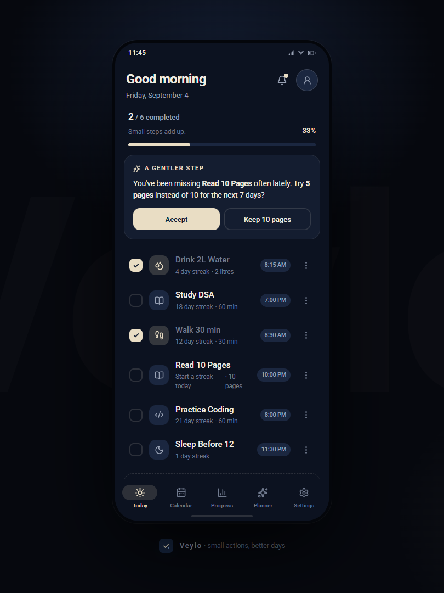
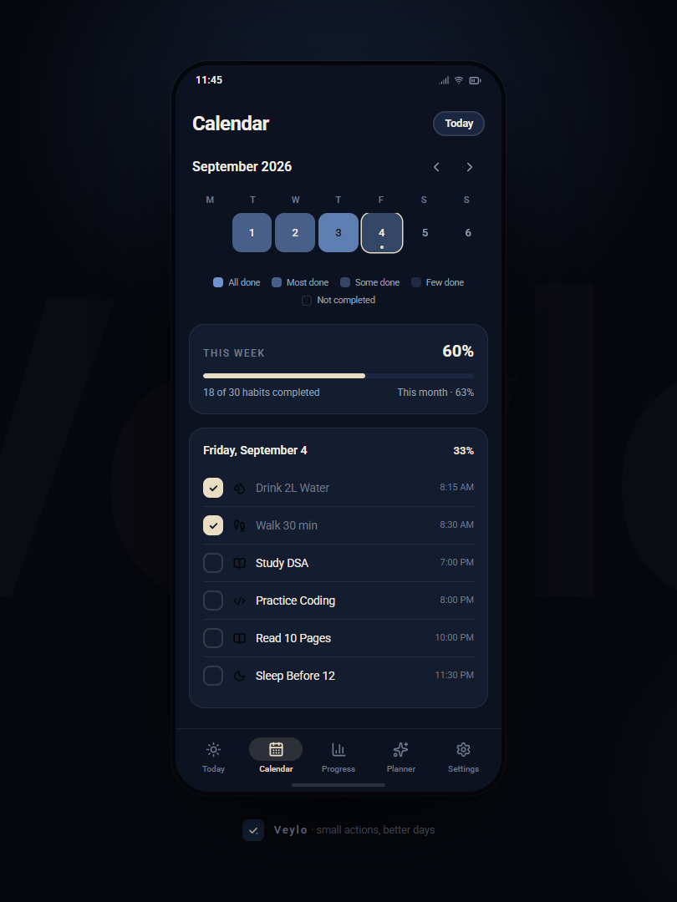
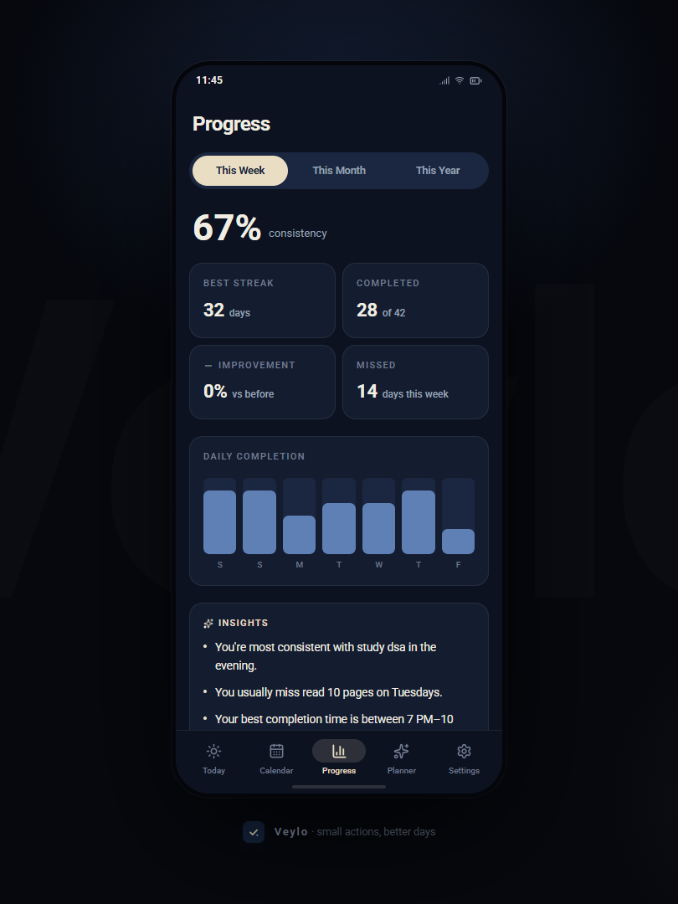
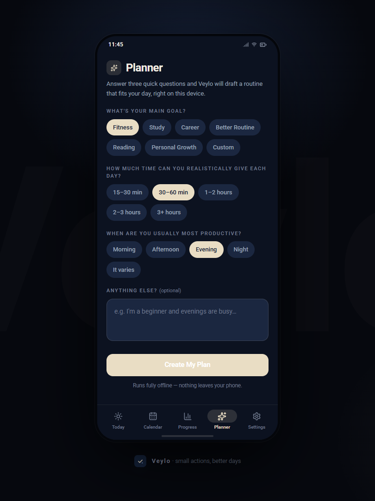
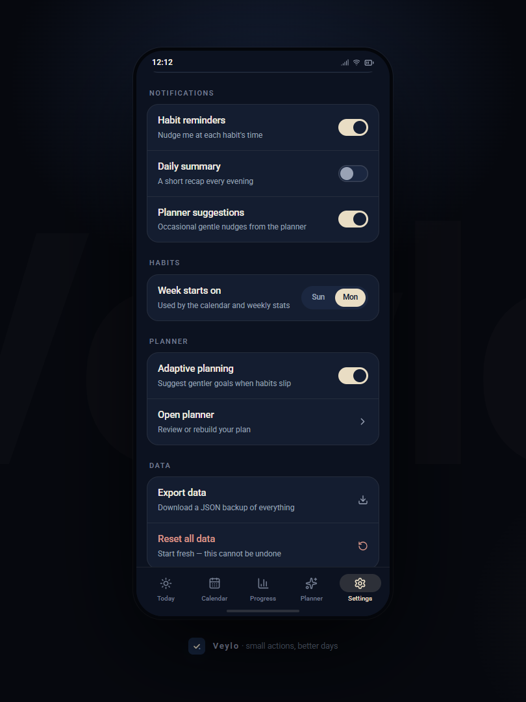
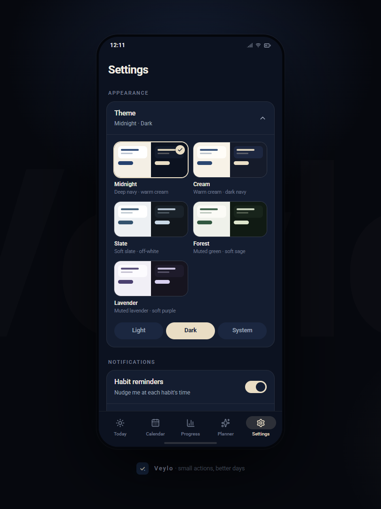

<div align="center">


# VEYLO

### Small habits. Better days.

**A calm, private habit tracker for everyday progress.**

Build a routine one small action at a time. Track your habits, see your streaks, and plan your day — all on your device.

<br />

[](https://github.com/hmmlavi/Veylo/releases/latest)
[](https://github.com/hmmlavi/Veylo/releases/latest)
[](https://react.dev/)
[](https://www.typescriptlang.org/)
[](https://vite.dev/)

<br />

[Explore the features](#-what-you-can-do) · [See the app](#-screenshots) · [Install on Android](#-install-on-android) · [Run it locally](#-run-veylo-locally) · [Privacy](#-privacy-first-by-design)

</div>

---

## 🌿 A little more intention, a little less noise

Veylo keeps habit tracking simple. Start with the day in front of you, check in as you go, and use your history to notice what is working. There are no accounts to create and no cloud service behind your data.

### ✨ What you can do

| | Feature | What it does |
|---|---|---|
| ✅ | **Build a routine** | Give each habit a name, icon, schedule, optional daily goal, time, and reminder; edit, archive, reorder, or remove it. |
| 🔥 | **Keep your momentum** | Check in with a tap and follow current and longest streaks over time. |
| 🗓️ | **See the bigger picture** | Browse a monthly completion calendar and open any day to review it. |
| 📈 | **Understand your progress** | View completion summaries, habit streaks, and weekly, monthly, and yearly trends. |
| 🧭 | **Plan a realistic day** | Spread selected habits across your available time windows with a deterministic, rule-based planner. |
| 🌗 | **Make it yours** | Choose Midnight, Cream, Slate, Forest, or Lavender, with Light, Dark, or System appearance. |
| 📴 | **Keep going offline** | The installed web app caches its shell; tracking and planning work locally. |

## 📸 Screenshots

<div align="center">

| Today | Calendar | Progress |
|:---:|:---:|:---:|
|  |  |  |
| **Check in for today** | **Review your history** | **Spot your progress** |

<br />

| Planner | Settings | Dark theme |
|:---:|:---:|:---:|
|  |  |  |
| **Make room for habits** | **Set your preferences** | **A quieter palette** |

</div>

## 📱 Install on Android

Download the current APK from [GitHub Releases](https://github.com/hmmlavi/Veylo/releases/latest), open it on your Android device, and follow Android’s install prompt. The app is a native Android shell around Veylo’s local web app; your habits stay on the device.

> **Release signing:** The published APK is debug-signed for direct installation and preview. It is not a Play Store release build.

## 🌐 Install as a web app

Veylo can also be installed from its hosted website in a supported browser. Choose **Add to Home Screen** or **Install app** from the browser menu. The PWA caches its app shell for offline use after the first visit.

## 🚀 Run Veylo locally

### Prerequisites

- Node.js 20.19+ or 22.12+
- npm 10 or newer

### Start the development server

```bash
git clone https://github.com/hmmlavi/Veylo.git
cd Veylo
npm install
npm run dev
```

Vite prints the local development address when the server starts.

### Build the web app

```bash
npm run build
npm run preview
```

The production site is generated in `dist/` and can be deployed to a static host.

### Build an Android APK

Install JDK 21 and Android SDK platform/build tools 36, then run:

```bash
npm run android:apk
```

The debug APK is created at `android/app/build/outputs/apk/debug/app-debug.apk`. To install it with Android platform tools:

```bash
adb install android/app/build/outputs/apk/debug/app-debug.apk
```

### Available commands

| Command | Description |
|---|---|
| `npm run dev` | Start Vite’s development server. |
| `npm run build` | Build the production web app. |
| `npm run preview` | Preview the production web build. |
| `npm run android:sync` | Build the web app and sync it into the Capacitor Android project. |
| `npm run android:apk` | Sync and build the Android debug APK. |
| `npm run icons:generate` | Generate the web and Android PNG icon sizes from the vector logo. |

## 🔒 Privacy first by design

- **No account or backend.** Veylo does not require a sign-in.
- **Local storage.** Habits, check-ins, and theme preference are stored on the device in browser storage.
- **No analytics or tracking.** Veylo does not send habit data to an analytics service.
- **Offline planning.** The planner is deterministic and does not call an AI model or external API.

Browser storage is specific to the browser and device. Clearing browser or app data can erase it, and there is no built-in cloud sync or backup yet.

## 🗓️ Plan around your real day

Tell the planner your focus, when you tend to be productive, and any notes that matter to your routine. Veylo uses a deterministic, rule-based planner to suggest habits and times. Review the suggestions and choose what to apply; planning does not make network requests.

## 🧭 How the app is organized

Veylo is a client-side React application. The same built web app is used by the browser/PWA and the Capacitor Android shell.

```text
React screens
  Today · Calendar · Progress · Planner · Settings
            │
            ├── Local habit state and storage
            ├── Date, statistics, and planning logic
            └── PWA app-shell cache for offline loading
```

### Project layout

```text
Veylo/
├── android/                 # Capacitor Android project
├── public/
│   ├── icons/               # Generated PWA icons
│   ├── veylo-logo.svg       # Editable vector logo source
│   └── manifest.webmanifest # PWA identity and install settings
├── scripts/
│   └── generate-app-icons.mjs # Generate web and Android icon sizes
├── screenshots/             # README app screenshots
└── src/
    ├── components/          # Reusable UI and sheets
    ├── lib/                 # State/storage, statistics, dates, planner
    └── screens/             # Today, Calendar, Progress, Planner, Settings
```

### Technology

| Area | Tools |
|---|---|
| UI | React 19, TypeScript 5, Tailwind CSS 4 |
| Build | Vite 7 |
| Motion and icons | Framer Motion, Lucide React |
| Android | Capacitor 8, Android SDK 36 |
| App data | Device-local browser storage |

## 🛠️ Contributing

Issues and focused pull requests are welcome. To work on a change:

1. Fork the repository and create a feature branch.
2. Install dependencies with `npm install`.
3. Run `npm run dev` while making changes.
4. Create a production build with `npm run build`.
5. Open a pull request with a clear summary and screenshots for visual changes.

Please keep changes small and follow the existing TypeScript and component patterns.

## 👤 Maintainer

Built by [hmmlavi](https://github.com/hmmlavi).

---

<div align="center">

**Small habits. Better days.**

If Veylo helps your routine, share it with someone building theirs.

</div>
